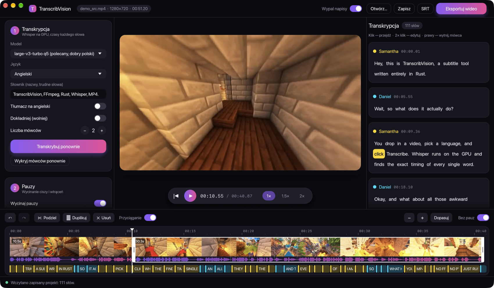
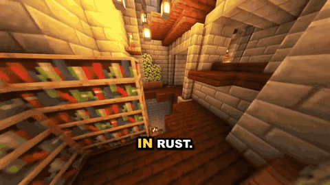

# TranscribVision (Rust)

Napisy do wideo, od zera w Rust. Wczytujesz film, wybierasz język (albo tłumaczenie na angielski) i kolory, klikasz **Transkrybuj**:



- **Transkrypcja**: whisper.cpp przez `whisper-rs`, na GPU (Metal), z czasami pojedynczych słów. Pole **Słownik** podpowiada nazwy własne i trudne słowa. Modele ggml pobiera się w aplikacji (polecany `large-v3-turbo-q5_0`, 547 MB) do `~/Library/Application Support/TranscribVision/models`.
- **Wycinanie pauz**: granice słów są dociągane do rzeczywistego dźwięku (energia RMS), potem cisza dłuższa niż próg jest wycinana, z zapasem po bokach. „Yyy/eee” usuwa się jednym przyciskiem, a pojedyncze słowa prawym przyciskiem.
- **Szybki podgląd**: odtwarzanie od razu bez wyciętych fragmentów, w tempie 1× / 1,5× / 2×. Obraz składa shader WGSL (YUV→RGB i nałożenie napisów) w egui + wgpu.
- **Animowane napisy**: Pop, Karaoke, Ramka pod słowem, Słowo po słowie, Tylko kolor. Aktywne słowo jest podświetlane kolorem mówcy, a mówców wykrywa się automatycznie (MFCC + k-średnich). Mówcę można też zmienić ręcznie (bardzo krótkie wtrącenia typu „Nice.” warto sprawdzić).
- **Montaż jak w CapCut**: oś czasu z miniaturami klatek, falą dźwięku i ścieżką napisów. Klipy przeciąga się myszką (reszta sama się rozsuwa, bez dziur), przycina ciągnięciem krawędzi (z przyciąganiem do granic słów i głowicy), tnie klawiszem `S`, duplikuje `⌘D`, usuwa `Delete`; `⌘Z` / `⇧⌘Z` cofa i ponawia. Napisy idą za klipami, a pauzy wycinają się dalej wewnątrz klipów. Zoom: `⌘` + kółko lub gest, `⇧←/→` skok o sekundę.
- **Eksport**: MP4 (H.264 + AAC) z wypalonymi napisami i wyciętymi pauzami, do tego SRT zwykły i SRT z kolorowym słowem.

Demo: rozmowa dwóch osób przepuszczona przez program. Pauzy wycięte (51 s → 41 s), aktywne słowo świeci kolorem mówcy (żółty / niebieski). Pełne wideo z dźwiękiem jest w [Releases](https://github.com/JakubJakubiak/TranscribVision/releases).



<sub>Tło: „Minecraft Parkour Gameplay No Copyright”, kanał Orbital - No Copyright Gameplay ([YouTube](https://www.youtube.com/watch?v=u7kdVe8q5zs)), licencja CC BY. Głosy w demo pochodzą z syntezy mowy macOS.</sub>

> Poprzednia wersja w Pythonie (stable-ts + moviepy + tkinter) jest na gałęzi [`old-version`](https://github.com/JakubJakubiak/TranscribVision/tree/old-version).

Cały tor mediów jest w czystym Rust, bez ffmpeg: dekodery H.264/HEVC, enkoder H.264, AAC i MP4 pochodzą z [craft-libs](https://github.com/storytold/craft-libs) (twórcy FilmCraft, MIT/Apache-2.0).

## Sprawdzone (M5, model large-v3-turbo q5)

- Polskie nagranie 17,7 s z dwoma głosami i wstawionymi pauzami: tekst bezbłędny, transkrypcja **~3 s na GPU**. Wycięto 3,6 s ciszy, a wynik transkrybuje się ponownie słowo w słowo, więc nic nie jest ucięte. Mówcy przypisani poprawnie.
- Angielskie demo: 39 słów, poprawnie.
- Czasy słów: DTW whisper.cpp (dokładne początki) i dociągnięcie do energii dźwięku (końce przed pauzą, spóźnione początki).
- Uwaga: `set_abort_callback_safe` w whisper-rs 0.16 ma błąd (losowe „przerwij” → `GenericError(-6)` „failed to encode”), dlatego program używa własnego wywołania na `AtomicBool`. Gdy GPU zawiedzie, transkrypcja sama przechodzi na CPU.

## Pobranie

Gotowa aplikacja na macOS (Apple Silicon) jest w [Releases](https://github.com/JakubJakubiak/TranscribVision/releases). Aplikacja nie jest podpisana, więc przy pierwszym uruchomieniu kliknij ją prawym przyciskiem → **Otwórz**.

## Uruchomienie ze źródeł

```bash
brew install cmake          # potrzebny do zbudowania whisper.cpp
cargo run --release         # okno
cargo run --release -- film.mp4
```

Tryb bez okna (testy, skrypty):

```bash
transcribvision cli film.mp4 --model large-v3-turbo-q5_0 --lang pl --speakers 2 --anim pop --out wynik.mp4
```

Projekt (słowa, styl, cięcia) zapisuje się obok filmu jako `film.napisy.json` i wczytuje automatycznie.

## Moduły

| Plik | Co robi |
|---|---|
| `media.rs` | MP4/MOV → klatki YUV 4:2:0 (H.264, HEVC 8/10-bit, obrót), audio → f32, resampling do 16 kHz |
| `transcribe.rs` | whisper-rs, katalog i pobieranie modeli, dopasowanie granic słów do dźwięku |
| `speakers.rs` | rozpoznawanie mówców bez modelu |
| `project.rs` | słowa, styl, wycinanie pauz, oś czasu źródło↔wynik, plansze napisów, SRT |
| `render.rs` | rasteryzacja czcionki, obrys (transformata odległości), cień, animacje; nakładanie na YUV |
| `preview.rs` + `preview.wgsl` | podgląd na GPU |
| `player.rs` | dźwięk przez cpal (zegar), dekodowanie obrazu w wątku |
| `export.rs` | eksport MP4 |
| `app.rs` | interfejs egui |
